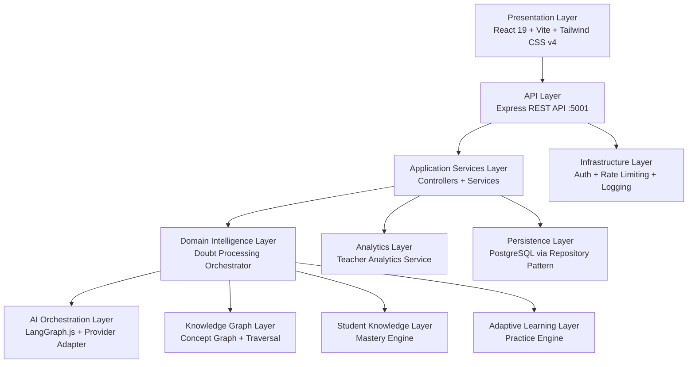
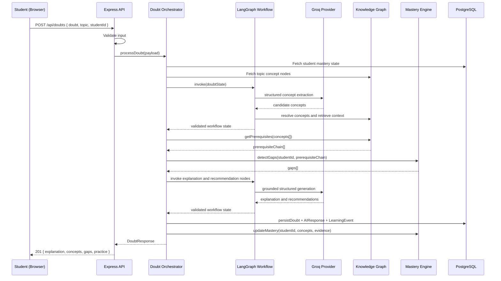
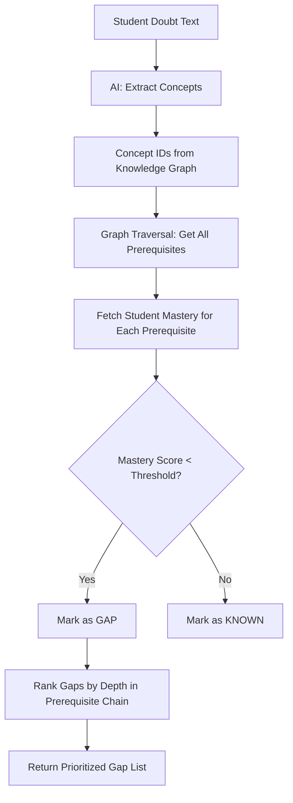
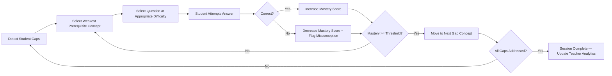
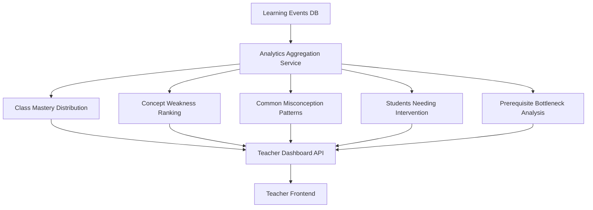
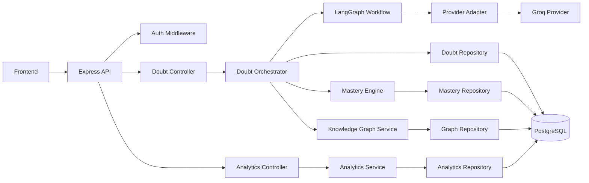
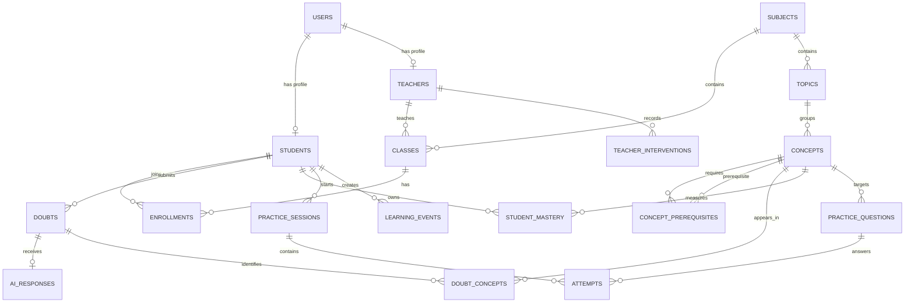
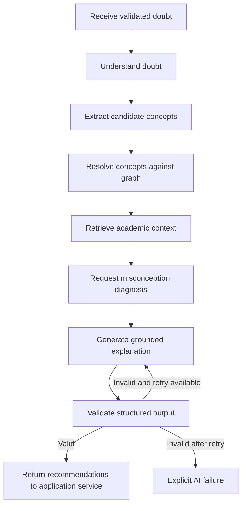

# KNOWRA — Project Blueprint
### Understand. Discover. Master.
**AI-Powered Adaptive Learning Platform**

> **Document Status:** Living Document — v1.0  
> **Purpose:** Single source of truth for the entire KNOWRA development team.  
> **Audience:** All contributors — frontend, backend, AI, graph, analytics, QA, DevOps.

---

## Table of Contents

- [Section A — Executive Overview](#section-a--executive-overview)
- [Section B — Product Requirements](#section-b--product-requirements)
- [Section C — System Architecture](#section-c--knowra-system-architecture)
- [Section D — Frontend Architecture](#section-d--frontend-architecture)
- [Section E — Backend Architecture](#section-e--backend-architecture)
- [Section F — Database and Data Model](#section-f--database-and-data-model)
- [Section G — Knowledge Graph Engine](#section-g--knowledge-graph-engine)
- [Section H — AI Intelligence Pipeline](#section-h--ai-intelligence-pipeline)
- [Section I — Student Knowledge Model](#section-i--student-knowledge-model)
- [Section J — Adaptive Practice Engine](#section-j--adaptive-practice-engine)
- [Section K — Teacher Analytics](#section-k--teacher-analytics)
- [Section L — Stitch UI Additions and Design System](#section-l--stitch-ui-additions-and-design-system)
- [Section M — API Contracts](#section-m--api-contracts)
- [Section N — Component Contribution Board](#section-n--component-contribution-board)
- [Section O — Git and Team Collaboration](#section-o--git-and-team-collaboration)
- [Section P — Coding Standards](#section-p--coding-standards)
- [Section Q — Security and Privacy](#section-q--security-and-privacy)
- [Section R — Testing Strategy](#section-r--testing-strategy)
- [Section S — Development Roadmap](#section-s--development-roadmap)
- [Section T — Project Evaluation and Research](#section-t--project-evaluation-and-research)
- [Section U — Demonstration Scenario](#section-u--demonstration-scenario)
- [Section V — Open Decisions and Assumptions](#section-v--open-decisions-and-assumptions)
- [Section W — Contributor Onboarding](#section-w--contributor-onboarding)

---

# Section A — Executive Overview

## Project Summary

KNOWRA is an AI-powered adaptive learning platform designed for college classrooms. It transforms the ordinary act of asking a doubt into a structured learning diagnosis. When a student submits a question, KNOWRA does not merely return an answer — it identifies the academic concepts involved, traces prerequisite dependencies through a knowledge graph, detects which foundational concepts the student likely has not mastered, and delivers a personalized explanation and practice sequence targeted at closing those gaps.

Teachers receive aggregated, actionable analytics showing which concepts are causing the most difficulty across the class, which students need intervention, and whether their teaching is producing measurable learning improvement.

## Problem Statement

Students in a classroom learn at different paces, but teachers cannot identify each student's specific weak concepts in real time. Generic doubt-solving systems provide answers without tracking prerequisite concepts or understanding why students repeatedly struggle. Consequently, conceptual learning gaps compound silently throughout the semester.

KNOWRA aims to solve this problem by transforming ordinary doubt-solving into an intelligent learning diagnosis and intervention system.

> **Core Philosophy:** KNOWRA does not merely answer what students ask. It diagnoses why students struggle to understand it.

## Vision

To become the standard intelligent learning companion for college classrooms — a system that makes every doubt a diagnostic opportunity and every practice session a targeted intervention.

## Objectives

1. Provide instant, context-aware doubt resolution to students.
2. Identify the academic concepts involved in every student doubt.
3. Detect missing prerequisite knowledge and conceptual gaps.
4. Represent academic concepts and their dependencies through a knowledge graph.
5. Maintain an evolving student knowledge state that improves with every interaction.
6. Deliver adaptive and personalized practice targeted at detected gaps.
7. Provide teachers with actionable class-level and student-level learning analytics.
8. Support targeted teaching interventions based on evidence.
9. Evaluate whether personalized learning measurably improves student understanding.

## Unique Selling Proposition

Most AI tutoring tools answer questions. KNOWRA diagnoses learning. The difference is:

| Ordinary AI Chatbot | KNOWRA |
|---|---|
| Returns an answer to the question asked | Identifies the concepts behind the question |
| Stateless — no memory of prior interactions | Maintains a persistent student knowledge state |
| No prerequisite awareness | Traces prerequisite chains through a knowledge graph |
| No gap detection | Explicitly identifies which prerequisites are weak |
| No personalization | Adapts practice to the student's specific gaps |
| No teacher visibility | Delivers aggregated class analytics to teachers |

## Target Users

| User | Description |
|---|---|
| Student | College student enrolled in a DSA course who submits doubts and completes practice |
| Teacher | Course instructor who monitors class learning and plans interventions |
| Administrator | (Future) Institution-level user managing courses and enrollments |

## Conceptual Transformation Pipeline

```
Student Question
      │
      ▼
Concept Identification        ← What concepts does this question involve?
      │
      ▼
Prerequisite Analysis         ← What must be understood before these concepts?
      │
      ▼
Student Knowledge State       ← What has this student already demonstrated mastery of?
      │
      ▼
Gap Detection                 ← Which prerequisites are weak or unmastered?
      │
      ▼
Personalized Intervention     ← Targeted explanation + adaptive practice
      │
      ▼
Updated Mastery               ← Student knowledge state evolves based on evidence
      │
      ▼
Teacher Analytics             ← Aggregated class-level insights for the teacher
```

## Initial Implementation Domain

KNOWRA will initially focus exclusively on **Data Structures and Algorithms (DSA)** for college students. This is a deliberate scoping decision:

- DSA has a well-defined, hierarchical concept dependency structure ideal for knowledge graph construction.
- It is a universal core subject in B.Tech CSE programs.
- The concept graph for DSA can be manually curated with high accuracy.

The architecture is designed to be **subject-independent**. The knowledge graph, mastery engine, and adaptive practice engine operate on abstract concept nodes and edges — they do not contain DSA-specific logic. Adding a new subject (DBMS, Operating Systems, Computer Networks) in the future requires:
1. Populating the concept graph with subject-specific nodes and edges.
2. Adding subject-specific practice questions.
3. No changes to the core engine.

**Do not implement multi-subject support in the MVP.**

## Expected Outcomes

- Students receive explanations that address root causes, not just surface questions.
- Students practice concepts targeted at their specific gaps.
- Teachers can identify class-wide bottlenecks without manually reviewing every student.
- The project demonstrates a measurable improvement in student understanding through pre/post evaluation.

---

# Section B — Product Requirements

## User Roles

### Student
A college student enrolled in a DSA course. Interacts with KNOWRA to submit doubts, receive AI explanations, view their knowledge map, and complete adaptive practice.

### Teacher
A course instructor. Views class-level and student-level analytics, identifies students needing intervention, and monitors learning progression.

### Administrator *(Future — P2)*
Institution-level management of courses, enrollments, and teacher assignments. Not required for MVP.

---

## Student Requirements

| ID | Requirement | Priority | Notes |
|---|---|---|---|
| SR-01 | Student registration and login | P0 | Email + password minimum |
| SR-02 | Student onboarding — select subject and class | P0 | DSA only for MVP |
| SR-03 | Student dashboard showing recent activity and mastery summary | P0 | |
| SR-04 | Submit a doubt with subject, topic, and free-text description | P0 | |
| SR-05 | Receive an AI-generated contextual explanation | P0 | Via Groq LLM |
| SR-06 | View which concepts were identified in the doubt | P0 | |
| SR-07 | View detected prerequisite gaps | P0 | |
| SR-08 | Ask contextual follow-up questions within the same session | P1 | |
| SR-09 | View personal learning history (all past doubts and responses) | P0 | |
| SR-10 | View personal knowledge map (concept mastery visualization) | P1 | |
| SR-11 | Complete adaptive practice sessions | P1 | |
| SR-12 | View practice results and feedback | P1 | |
| SR-13 | View mastery progression over time | P1 | |
| SR-14 | Receive practice recommendations based on gaps | P1 | |
| SR-15 | View misconceptions identified by the AI | P2 | |

## Teacher Requirements

| ID | Requirement | Priority | Notes |
|---|---|---|---|
| TR-01 | Teacher registration and login | P0 | |
| TR-02 | Class dashboard showing overall learning health | P0 | |
| TR-03 | View all students in a class with mastery summaries | P0 | |
| TR-04 | View concept-level performance across the class | P0 | |
| TR-05 | View most common doubts and misconceptions | P0 | |
| TR-06 | Identify students with weak prerequisite mastery | P0 | |
| TR-07 | View individual student learning profiles | P1 | |
| TR-08 | Receive intervention recommendations | P1 | |
| TR-09 | Monitor teaching effectiveness over time | P1 | |
| TR-10 | View prerequisite bottleneck analysis | P1 | |
| TR-11 | Export class analytics report | P2 | |

## System Requirements

| ID | Requirement | Priority | Notes |
|---|---|---|---|
| SYS-01 | JWT-based authentication and authorization | P0 | |
| SYS-02 | Role-based access control (student vs teacher) | P0 | |
| SYS-03 | AI workflow processing via LangGraph.js with Groq inference | P0 | Runs inside the existing Express backend |
| SYS-04 | Concept extraction from student doubts | P0 | |
| SYS-05 | Knowledge graph storage and traversal | P0 | |
| SYS-06 | Student mastery tracking per concept | P0 | |
| SYS-07 | Adaptive practice question selection | P1 | |
| SYS-08 | Teacher analytics aggregation | P0 | |
| SYS-09 | PostgreSQL data persistence | P0 | |
| SYS-10 | Input validation on all API endpoints | P0 | |
| SYS-11 | Structured AI output validation | P0 | |
| SYS-12 | API rate limiting | P1 | |
| SYS-13 | AI provider abstraction layer | P0 | Required to avoid coupling LangGraph to Groq |
| SYS-14 | Retry and fallback for AI failures | P1 | |
| SYS-15 | Logging and error monitoring | P0 | |

---

# Section C — KNOWRA System Architecture

## Architecture Overview

KNOWRA uses a layered architecture. Each layer has a single, well-defined responsibility. Layers communicate only with adjacent layers through defined interfaces.



## Layer Descriptions

### Layer 1 — Presentation Layer
- **Technology:** React 19, Vite, Tailwind CSS v4
- **Port:** 5173 (development)
- **Responsibilities:** Render UI, manage local component state, call backend API, display AI responses, visualize knowledge maps and mastery.
- **Inputs:** User interactions, API responses
- **Outputs:** HTTP requests to `/api/*`
- **Dependencies:** Backend API Layer
- **Existing:** Basic App.jsx with doubt submission form and health check. Vite proxy to `:5001` configured.

### Layer 2 — API and Application Layer
- **Technology:** Node.js, Express
- **Port:** 5001 (development)
- **Responsibilities:** Route HTTP requests, validate inputs, delegate to services, format responses.
- **Inputs:** HTTP requests from frontend
- **Outputs:** JSON responses
- **Existing:** `app.js`, `server.js`, `routes/api.js`, `middlewares/errorHandler.js`. GET `/`, GET `/api/health`, GET `/api/doubts`, POST `/api/doubts` are implemented as stubs.

### Layer 3 — Domain and Learning Intelligence Layer *(Proposed)*
- **Responsibilities:** Coordinate the Express request lifecycle and deterministic learning services around the AI workflow.
- **Key module:** `DoubtProcessingOrchestrator`
- **Boundary:** Calls LangGraph for AI workflow execution, then calls graph, mastery, persistence, practice, and analytics services for authoritative operations.

### Layer 4 — AI Orchestration Layer *(Proposed)*
- **Framework:** LangGraph.js running inside the existing Node.js/Express backend.
- **Responsibilities:** Coordinate stateful AI workflow nodes for doubt understanding, concept extraction, context retrieval, prerequisite analysis, misconception diagnosis, explanation generation, output validation, and adaptive recommendations.
- **Initial provider:** Groq, accessed through a provider abstraction.
- **Optional integration:** LangChain.js integrations may simplify chat model adapters, structured output, tool interfaces, or retrieval, but LangChain is not the workflow authority.
- **Boundary:** LangGraph orchestrates AI reasoning and tool calls; it does not own authoritative graph traversal, mastery calculations, evidence persistence, practice scoring, authorization, or teacher analytics.

### Layer 5 — Knowledge Graph Layer *(Proposed)*
- **Responsibilities:** Store concept nodes and prerequisite edges. Traverse prerequisite chains. Identify missing prerequisites for a given concept set.
- **Storage:** PostgreSQL tables (MVP). Neo4j optional future enhancement.

### Layer 6 — Student Knowledge and Mastery Layer *(Proposed)*
- **Responsibilities:** Maintain per-student, per-concept mastery scores. Update mastery based on learning events. Identify gaps.

### Layer 7 — Adaptive Learning Layer *(Proposed)*
- **Responsibilities:** Select practice questions based on student gaps. Evaluate answers. Update mastery after practice.

### Layer 8 — Analytics Layer *(Proposed)*
- **Responsibilities:** Aggregate student mastery data into class-level insights. Identify bottlenecks and intervention candidates.

### Layer 9 — Persistence Layer *(Proposed)*
- **Technology:** PostgreSQL
- **Responsibilities:** All database reads and writes via repository pattern. No SQL in controllers or services.

### Layer 10 — Infrastructure and Security Layer *(Proposed)*
- **Responsibilities:** JWT authentication, role-based access control, rate limiting, request logging, secret management.

LangGraph.js is evaluated as an in-process backend dependency, not as a separate server. No Python AI microservice is planned unless a concrete requirement emerges, such as a Python-only model runtime that cannot be accessed through the provider abstraction.

---

## Doubt Processing Pipeline



## Knowledge Gap Detection Pipeline



## Adaptive Learning Cycle



## Teacher Analytics Pipeline



## Component Dependency Graph



---

# Section D — Frontend Architecture

## Design Principles

- No single massive App.jsx. Each page is its own component.
- Feature-based folder organization, not type-based.
- API calls are centralized in `/api` clients, never inline in components.
- Global state (auth, user) via React Context. Server state via custom hooks.
- All pages are protected by route guards based on user role.

## Proposed Directory Structure

```
frontend/src/
├── api/                        # Centralized API client functions
│   ├── client.js               # Base fetch wrapper with auth headers
│   ├── authApi.js              # Login, register, logout
│   ├── doubtsApi.js            # Submit doubt, fetch history
│   ├── practiceApi.js          # Fetch questions, submit attempts
│   ├── analyticsApi.js         # Teacher analytics endpoints
│   └── conceptsApi.js          # Knowledge graph, mastery data
│
├── components/                 # Reusable UI components
│   ├── ui/                     # Primitive components
│   │   ├── Button.jsx
│   │   ├── Card.jsx
│   │   ├── Badge.jsx
│   │   ├── Input.jsx
│   │   ├── Textarea.jsx
│   │   ├── Spinner.jsx
│   │   ├── Modal.jsx
│   │   └── ProgressBar.jsx
│   ├── layout/
│   │   ├── AppShell.jsx        # Sidebar + topbar wrapper
│   │   ├── Sidebar.jsx
│   │   ├── Topbar.jsx
│   │   └── PageContainer.jsx
│   └── shared/
│       ├── ConceptBadge.jsx    # Displays a concept tag
│       ├── MasteryBar.jsx      # Visual mastery score bar
│       ├── GapAlert.jsx        # Displays detected gaps
│       └── EmptyState.jsx      # Reusable empty state UI
│
├── features/                   # Feature modules
│   ├── auth/
│   │   ├── LoginPage.jsx
│   │   ├── RegisterPage.jsx
│   │   └── OnboardingPage.jsx
│   ├── student/
│   │   ├── StudentDashboard.jsx
│   │   ├── AskDoubt/
│   │   │   ├── AskDoubtPage.jsx
│   │   │   ├── DoubtForm.jsx
│   │   │   ├── AIResponseCard.jsx
│   │   │   ├── ConceptList.jsx
│   │   │   └── GapList.jsx
│   │   ├── KnowledgeMap/
│   │   │   ├── KnowledgeMapPage.jsx
│   │   │   └── ConceptGraphView.jsx
│   │   ├── Practice/
│   │   │   ├── PracticePage.jsx
│   │   │   ├── QuestionCard.jsx
│   │   │   └── PracticeResults.jsx
│   │   ├── History/
│   │   │   ├── HistoryPage.jsx
│   │   │   └── DoubtHistoryItem.jsx
│   │   └── Progress/
│   │       └── ProgressPage.jsx
│   └── teacher/
│       ├── TeacherDashboard.jsx
│       ├── ClassAnalytics/
│       │   ├── ClassAnalyticsPage.jsx
│       │   ├── ConceptWeaknessChart.jsx
│       │   └── MasteryDistribution.jsx
│       ├── StudentProfile/
│       │   ├── StudentProfilePage.jsx
│       │   └── StudentMasteryDetail.jsx
│       └── Interventions/
│           └── InterventionPlannerPage.jsx
│
├── hooks/                      # Custom React hooks
│   ├── useAuth.js              # Auth context consumer
│   ├── useDoubt.js             # Submit doubt, track loading/error
│   ├── useMastery.js           # Fetch student mastery data
│   ├── usePractice.js          # Practice session state
│   └── useAnalytics.js         # Teacher analytics data
│
├── context/
│   └── AuthContext.jsx         # Global auth state (user, token, role)
│
├── router/
│   └── AppRouter.jsx           # React Router config + route guards
│
├── utils/
│   ├── validators.js           # Client-side form validation
│   └── formatters.js           # Date, score, label formatters
│
├── App.jsx                     # Mounts AuthContext + AppRouter only
├── main.jsx                    # React entry point (existing)
└── index.css                   # Tailwind CSS entry (existing)
```

## Page Responsibilities

| Page | Route | Role | Responsibility |
|---|---|---|---|
| LoginPage | `/login` | Public | Email/password login form |
| RegisterPage | `/register` | Public | New user registration |
| OnboardingPage | `/onboarding` | Student | Select class and subject after first login |
| StudentDashboard | `/dashboard` | Student | Mastery summary, recent doubts, quick actions |
| AskDoubtPage | `/ask` | Student | Submit doubt, view AI explanation and gaps |
| KnowledgeMapPage | `/map` | Student | Visual concept graph with mastery overlay |
| PracticePage | `/practice` | Student | Adaptive practice session |
| HistoryPage | `/history` | Student | All past doubts and AI responses |
| ProgressPage | `/progress` | Student | Mastery progression charts |
| TeacherDashboard | `/teacher` | Teacher | Class health overview |
| ClassAnalyticsPage | `/teacher/analytics` | Teacher | Concept weakness, misconceptions |
| StudentProfilePage | `/teacher/students/:id` | Teacher | Individual student mastery detail |
| InterventionPlannerPage | `/teacher/interventions` | Teacher | Students needing intervention |

## Routing and Guards

```jsx
// router/AppRouter.jsx (proposed structure)
// Public routes: /login, /register
// Protected student routes: require role === 'student'
// Protected teacher routes: require role === 'teacher'
// Redirect unauthenticated users to /login
```

## State Management Strategy

| State Type | Solution | Rationale |
|---|---|---|
| Auth (user, token, role) | React Context | Global, rarely changes |
| Server data (doubts, mastery) | Custom hooks + useState | Simple, no extra library needed for MVP |
| Form state | Local useState | Scoped to form component |
| Complex async state | P1: Consider React Query | After MVP stabilizes |

---

# Section E — Backend Architecture

## Design Principles

- Business logic lives in **Services**, not Controllers.
- Database access lives in **Repositories**, not Services.
- Controllers only: validate input → call service → format response.
- Domain logic (mastery calculation, gap detection) lives in **Domain modules**.
- AI calls are isolated in **AI services** behind a provider interface.

## Layer Responsibilities

| Layer | Responsibility | Must NOT contain |
|---|---|---|
| Route | Map HTTP method + path to controller | Any logic |
| Controller | Parse request, call service, return response | Business logic, DB calls |
| Service | Orchestrate business operations | Direct DB queries, HTTP parsing |
| Repository | Execute DB queries, return domain objects | Business logic |
| Domain | Pure calculation logic (mastery, gaps) | DB calls, HTTP, AI calls |
| Middleware | Cross-cutting concerns (auth, logging, errors) | Business logic |

## Proposed Directory Structure

```
backend/src/
├── config/
│   ├── database.js             # PostgreSQL connection pool
│   ├── ai.js                   # AI provider configuration
│   └── env.js                  # Validated environment variables
│
├── routes/
│   ├── api.js                  # EXISTING — will be refactored
│   ├── authRoutes.js
│   ├── doubtRoutes.js
│   ├── practiceRoutes.js
│   ├── analyticsRoutes.js
│   └── conceptRoutes.js
│
├── controllers/
│   ├── authController.js
│   ├── doubtController.js
│   ├── practiceController.js
│   ├── analyticsController.js
│   └── conceptController.js
│
├── services/
│   ├── authService.js
│   ├── doubtService.js         # Orchestrates doubt processing
│   ├── practiceService.js
│   ├── analyticsService.js
│   └── conceptService.js
│
├── domain/
│   ├── masteryEngine.js        # Pure mastery score calculations
│   ├── gapDetector.js          # Gap identification logic
│   ├── practiceSelector.js     # Question selection algorithm
│   └── prerequisiteTraversal.js # Graph traversal algorithms
│
├── ai/
│   ├── provider.js              # Provider-neutral interface
│   ├── groqProvider.js           # Groq implementation
│   ├── langGraphWorkflow.js     # LangGraph.js state graph
│   ├── nodes/                   # AI reasoning and validation nodes
│   │   ├── understandDoubt.js
│   │   ├── extractConcepts.js
│   │   ├── retrieveContext.js
│   │   ├── diagnoseMisconceptions.js
│   │   ├── generateExplanation.js
│   │   └── validateOutput.js
│   ├── promptManager.js          # Versioned prompt templates
│   ├── outputValidator.js        # Validate structured AI output
│   └── aiService.js              # Workflow entry point
│
├── graph/
│   ├── graphRepository.js      # DB queries for concept graph
│   ├── graphService.js         # Graph operations (traversal, validation)
│   └── graphSeeder.js          # DSA concept graph seed data
│
├── repositories/
│   ├── userRepository.js
│   ├── doubtRepository.js
│   ├── masteryRepository.js
│   ├── practiceRepository.js
│   └── analyticsRepository.js
│
├── middlewares/
│   ├── errorHandler.js         # EXISTING
│   ├── authMiddleware.js       # JWT verification
│   ├── roleMiddleware.js       # Role-based access control
│   ├── validateMiddleware.js   # Request body validation
│   └── rateLimiter.js          # API rate limiting
│
├── validators/
│   ├── authValidators.js
│   ├── doubtValidators.js
│   └── practiceValidators.js
│
├── utils/
│   ├── logger.js               # Structured logging
│   ├── asyncHandler.js         # Wrap async route handlers
│   └── apiResponse.js          # Consistent response formatter
│
├── app.js                      # EXISTING — will add new routes
└── server.js                   # EXISTING
```

## Dependency Rules

```
Routes → Controllers → Services → Repositories → Database
                    ↘ Domain (pure functions, no I/O)
                    ↘ AI Service → LangGraph Workflow → Provider Adapter
                    ↘ Graph Services → Graph Repository
```

- A controller may call multiple services.
- A service may call multiple repositories and domain functions.
- A repository may only call the database.
- Domain functions are pure — no I/O, no side effects.
- AI nodes may call approved read-only tools and the provider adapter; only application services call persistence and authoritative deterministic engines.
- LangGraph state is workflow state, not the student record of truth.
- LangGraph nodes must not directly write mastery, evidence, practice scores, analytics, or authorization state.

---


# Section F — Database and Data Model

## Database Decision

**PostgreSQL is the proposed MVP database; it is not implemented in the current repository.** PostgreSQL fits KNOWRA because users, classes, enrollments, concepts, doubts, attempts, and learning events have strong relationships and require transactions. It also supports reliable constraints, indexes, reporting queries, JSONB for validated AI payloads, and recursive common-table expressions for prerequisite traversal.

PostgreSQL alone is sufficient for the MVP knowledge graph. A graph abstraction in the application should hide storage details so that Neo4j can be evaluated later only if graph size or traversal latency proves PostgreSQL insufficient. MongoDB is not required for the current domain.

## Conceptual Entities

| Entity | Purpose | Key fields and relationships |
|---|---|---|
| `users` | Shared identity and authorization record | `id`, `email`, `password_hash`, `role`, timestamps; one-to-one with student or teacher |
| `students` | Student profile | `user_id`, display name, enrollment metadata |
| `teachers` | Teacher profile | `user_id`, display name, department |
| `classes` | A course offering or classroom | `id`, `teacher_id`, `subject_id`, term, name |
| `enrollments` | Student membership in a class | `class_id`, `student_id`, unique pair |
| `subjects` | Academic subject catalog | `id`, code, name; DSA is the MVP seed |
| `topics` | Broad grouping of concepts | `subject_id`, name, ordering |
| `concepts` | Atomic knowledge units | `topic_id`, slug, name, objective, difficulty, version, active flag |
| `concept_prerequisites` | Directed prerequisite edge | `concept_id`, `prerequisite_id`, edge type, unique pair, no self-edge |
| `doubts` | Student question and processing status | `student_id`, class_id, text, topic, status, idempotency key |
| `ai_responses` | Explanation and model metadata | `doubt_id`, provider, model, latency, validated JSON payload |
| `doubt_concepts` | Concepts extracted from a doubt | `doubt_id`, `concept_id`, confidence, evidence |
| `student_mastery` | Current student-concept state | student, concept, score, evidence counts, confidence, last evidence |
| `practice_questions` | Curated or generated question bank | concept, difficulty, type, prompt, answer rubric, active flag |
| `practice_sessions` | A bounded adaptive learning session | student, target concepts, status, timestamps |
| `attempts` | Student answer to a practice question | session, question, answer, correctness, score, feedback |
| `misconceptions` | Known misconception signal | student, concept, label, evidence, resolved flag |
| `learning_events` | Append-only evidence stream | actor, type, source entity, concept, payload, occurred at |
| `teacher_interventions` | Teacher action and follow-up | teacher, class, student/concept, action, outcome |



## Proposed SQL Schema

The following is a logical schema, not a migration and not an implemented database.

```sql
CREATE TYPE user_role AS ENUM ('student', 'teacher');
CREATE TYPE doubt_status AS ENUM ('pending', 'processing', 'completed', 'failed');

CREATE TABLE users (
  id UUID PRIMARY KEY,
  email TEXT NOT NULL UNIQUE,
  password_hash TEXT NOT NULL,
  role user_role NOT NULL,
  created_at TIMESTAMPTZ NOT NULL DEFAULT now(),
  updated_at TIMESTAMPTZ NOT NULL DEFAULT now()
);

CREATE TABLE subjects (
  id UUID PRIMARY KEY,
  code TEXT NOT NULL UNIQUE,
  name TEXT NOT NULL,
  active BOOLEAN NOT NULL DEFAULT true
);

CREATE TABLE classes (
  id UUID PRIMARY KEY,
  teacher_id UUID NOT NULL REFERENCES users(id),
  subject_id UUID NOT NULL REFERENCES subjects(id),
  name TEXT NOT NULL,
  term TEXT NOT NULL
);

CREATE TABLE topics (
  id UUID PRIMARY KEY,
  subject_id UUID NOT NULL REFERENCES subjects(id),
  name TEXT NOT NULL,
  UNIQUE (subject_id, name)
);

CREATE TABLE concepts (
  id UUID PRIMARY KEY,
  topic_id UUID NOT NULL REFERENCES topics(id),
  slug TEXT NOT NULL UNIQUE,
  name TEXT NOT NULL,
  learning_objective TEXT NOT NULL,
  difficulty SMALLINT NOT NULL CHECK (difficulty BETWEEN 1 AND 5),
  graph_version INTEGER NOT NULL DEFAULT 1,
  active BOOLEAN NOT NULL DEFAULT true
);

CREATE TABLE concept_prerequisites (
  concept_id UUID NOT NULL REFERENCES concepts(id),
  prerequisite_id UUID NOT NULL REFERENCES concepts(id),
  edge_type TEXT NOT NULL DEFAULT 'requires',
  PRIMARY KEY (concept_id, prerequisite_id),
  CHECK (concept_id <> prerequisite_id)
);

CREATE TABLE doubts (
  id UUID PRIMARY KEY,
  student_id UUID NOT NULL REFERENCES users(id),
  class_id UUID REFERENCES classes(id),
  subject_id UUID REFERENCES subjects(id),
  topic TEXT,
  question TEXT NOT NULL CHECK (char_length(question) BETWEEN 1 AND 5000),
  status doubt_status NOT NULL DEFAULT 'pending',
  idempotency_key TEXT,
  created_at TIMESTAMPTZ NOT NULL DEFAULT now(),
  UNIQUE (student_id, idempotency_key)
);

CREATE TABLE student_mastery (
  student_id UUID NOT NULL REFERENCES users(id),
  concept_id UUID NOT NULL REFERENCES concepts(id),
  mastery_score NUMERIC(5,4) NOT NULL CHECK (mastery_score BETWEEN 0 AND 1),
  evidence_count INTEGER NOT NULL DEFAULT 0 CHECK (evidence_count >= 0),
  correct_attempts INTEGER NOT NULL DEFAULT 0,
  incorrect_attempts INTEGER NOT NULL DEFAULT 0,
  confidence NUMERIC(5,4) NOT NULL DEFAULT 0 CHECK (confidence BETWEEN 0 AND 1),
  last_evidence_at TIMESTAMPTZ,
  PRIMARY KEY (student_id, concept_id)
);
```

Additional tables follow the same conventions: UUID primary keys, foreign keys, `created_at`/`updated_at`, explicit check constraints, and indexes on foreign keys and time-based queries. Sensitive free text should be access-controlled and retained only as long as needed for the academic purpose.

Recommended indexes:

```sql
CREATE INDEX doubts_student_created_idx ON doubts (student_id, created_at DESC);
CREATE INDEX mastery_concept_score_idx ON student_mastery (concept_id, mastery_score);
CREATE INDEX events_class_time_idx ON learning_events (class_id, occurred_at DESC);
CREATE INDEX edges_prerequisite_idx ON concept_prerequisites (prerequisite_id);
```

## Example Records

```json
{
  "concept": {
    "slug": "binary-search",
    "name": "Binary Search",
    "difficulty": 3,
    "learningObjective": "Apply binary search to a sorted search space and justify its O(log n) complexity."
  },
  "mastery": {
    "studentId": "student-uuid",
    "conceptId": "concept-uuid",
    "masteryScore": 0.62,
    "evidenceCount": 5,
    "correctAttempts": 3,
    "incorrectAttempts": 2,
    "confidence": 0.55
  }
}
```

## Data Lifecycle

1. A validated request creates a `doubts` row and an initial `learning_event`.
2. AI output is validated before `ai_responses` and `doubt_concepts` are written.
3. A transaction writes evidence and updates `student_mastery`.
4. Practice attempts append events and update the same mastery row.
5. Analytics reads aggregated, authorized data; it does not mutate source evidence.
6. Failed processing remains visible with an error code and can be safely retried using the idempotency key.

---

# Section G — Knowledge Graph Engine

## Representation

A concept node is an atomic learning objective. A prerequisite edge `A -> B` means B requires A, so traversal starts at the requested concept and walks toward its prerequisites. Each node contains a stable slug, subject/topic, objective, difficulty, aliases, and graph version. Optional misconception edges can associate a misconception label with the concept it affects, but they must not replace prerequisite edges.

Example DSA progression:

```text
Arrays -> Indexing -> Searching -> Binary Search -> Search Space Reduction
```

Other useful chains:

```text
Recursion -> Call Stack -> Tree Traversal
Linked Lists -> Pointer Manipulation -> Linked List Reversal
Sorting -> Comparison Model -> Merge Sort -> Divide and Conquer
Graphs -> Adjacency Representation -> BFS/DFS -> Shortest Path
Recursion -> Overlapping Subproblems -> Memoization -> Dynamic Programming
```

```json
{
  "version": 1,
  "nodes": [
    {"id": "arrays", "type": "concept", "difficulty": 1},
    {"id": "indexing", "type": "concept", "difficulty": 1},
    {"id": "binary-search", "type": "concept", "difficulty": 3}
  ],
  "edges": [
    {"from": "binary-search", "to": "searching", "type": "requires"},
    {"from": "searching", "to": "indexing", "type": "requires"},
    {"from": "indexing", "to": "arrays", "type": "requires"}
  ]
}
```

## Graph Operations

| Operation | Behavior |
|---|---|
| Create | Validate node fields, unique slugs, subject ownership, and edge targets |
| Validate | Reject self-edges, missing nodes, duplicate edges, and cycles |
| Traverse | Depth-first or breadth-first traversal with a visited set and maximum depth |
| Order | Topological sort prerequisites from foundational to advanced |
| Detect gaps | Join traversed nodes to mastery and rank weak prerequisites |
| Version | Publish immutable graph versions; new versions preserve historical evidence references |
| Edit | Teachers can propose or approve scoped edits; a reviewer confirms graph validity |

Graph cycle detection is a hard validation failure. Traversal must have a maximum node count and timeout guard even after validation. If a concept is missing, return a typed `CONCEPT_NOT_FOUND` error rather than silently treating it as mastered.

## Storage Recommendation

PostgreSQL stores nodes and edges with foreign keys and indexes. Recursive CTEs support normal prerequisite chains, while application-level traversal makes ranking, caching, and provider changes explicit. Neo4j becomes reasonable only after measured evidence of large graphs, frequent multi-hop queries, or unacceptable PostgreSQL traversal latency. `GraphRepository` is the abstraction boundary so the rest of KNOWRA remains storage-independent.

---

# Section H — AI Intelligence Pipeline

## LangGraph.js Orchestration Decision

KNOWRA will use **LangGraph.js as the primary AI workflow orchestration framework**. It will run inside the existing Node.js/Express backend; a separate Python AI microservice is not part of the MVP. LangGraph is appropriate because the doubt-solving workflow is multi-step, stateful, inspectable, retryable, and expected to grow from one-shot explanations into learning intelligence workflows.

LangGraph may orchestrate:

- Doubt understanding and intent classification.
- Concept extraction and candidate resolution.
- Context retrieval from approved graph and student-state tools.
- Prerequisite analysis requests.
- Misconception diagnosis.
- Explanation generation.
- Structured output validation and repair.
- Adaptive learning recommendations.

The workflow state is temporary execution state. It is not authoritative student state. LangGraph nodes may call deterministic services through narrow interfaces, but they must not directly mutate mastery records, learning evidence, practice scores, authorization state, or teacher analytics. The application service commits authoritative results after validation and policy checks.

## Provider-Independent Model Integration

Groq is the initial inference provider. Application code depends on a provider interface rather than Groq SDK types:

```js
export class AIProvider {
  async generateStructured({ messages, schema, timeoutMs, metadata }) {
    throw new Error('AIProvider.generateStructured must be implemented');
  }
}
```

`GroqProvider` owns SDK calls, model configuration, timeout handling, usage metadata, and provider error translation. LangGraph depends on `AIProvider`; it does not depend directly on Groq. LangChain.js integrations may be used for model adapters, structured-output helpers, tool interfaces, or retrieval when they reduce implementation complexity, but LangGraph remains the workflow boundary. A future provider implements the same interface without changing controllers, graph logic, or mastery calculations.

## Proposed LangGraph State and Nodes

```js
const DoubtWorkflowState = {
  request: null,
  academicContext: null,
  candidateConcepts: [],
  resolvedConcepts: [],
  prerequisiteContext: [],
  masterySnapshot: [],
  gapCandidates: [],
  misconceptionCandidates: [],
  explanation: null,
  practiceRecommendations: [],
  validationErrors: [],
  trace: []
};
```

Suggested graph:



The deterministic application service performs graph traversal, reads the mastery snapshot, ranks gaps, persists evidence, updates mastery, scores practice, and aggregates teacher analytics outside the graph. The workflow can receive those results as read-only context and can recommend actions, but it cannot approve or commit them.

## Doubt Processing

1. Express validates the request and the application service creates an idempotent doubt record.
2. The LangGraph workflow receives the doubt and academic context.
3. AI nodes propose candidate concepts, evidence spans, and misconception hypotheses.
4. Read-only graph tools resolve candidates and retrieve prerequisite context.
5. The deterministic gap detector compares prerequisites with a mastery snapshot.
6. LangGraph generates an explanation and practice recommendations grounded in approved context.
7. Structured output validation rejects unknown IDs, malformed scores, unsupported claims, and oversized output.
8. The deterministic application service persists the validated response and learning evidence in a transaction.
9. The mastery engine updates student state using deterministic evidence rules.
10. The adaptive learning service selects practice; the analytics service aggregates authorized events.
11. Express returns a versioned response to the student.

The LLM proposes concepts, explanations, and recommendations. Deterministic graph algorithms resolve dependencies. The LLM must never independently assign or modify authoritative mastery scores.

## Structured Output Schemas

```json
{
  "conceptExtraction": {
    "concepts": [
      {"conceptId": "binary-search", "confidence": 0.91, "evidence": "mid = low + ..."}
    ],
    "unknownTerms": []
  },
  "misconceptions": [
    {
      "conceptId": "integer-overflow",
      "label": "unsafe midpoint arithmetic",
      "confidence": 0.71,
      "evidence": "The student is concerned about overflow."
    }
  ],
  "explanation": {
    "summary": "Use the difference before adding it to low.",
    "steps": ["...", "..."],
    "prerequisiteReminders": ["integer arithmetic"],
    "checkForUnderstanding": "What range can high - low take?"
  },
  "practiceRecommendations": [
    {"conceptId": "integer-overflow", "difficulty": 2, "reason": "Direct prerequisite"}
  ]
}
```

Practice generation, if enabled, must return question type, concept ID, difficulty, prompt, expected answer criteria, and a safety flag. Curated questions are preferred for MVP; generated questions require human review or a strict validation pipeline.

## Reliability and Cost Controls

- Keep prompts versioned and include only the minimum student context.
- Set request timeouts, bounded retries with jitter, and a circuit breaker for provider outages.
- Rate-limit per user and per IP; enforce maximum question length and output tokens.
- Record provider, model, latency, token usage, prompt version, and validation outcome.
- Never expose API keys to the frontend.
- On timeout, return a clear retryable error and preserve the submitted doubt; do not fabricate an answer.
- On invalid output, log the validation code, retry once with a repair prompt, then fail explicitly.
- Ground explanations in graph data and show uncertainty where confidence is low.
- Evaluate concept extraction and explanation quality using a labelled validation set before demos.

---

# Section I — Student Knowledge Model

## State Definition

Each student-concept pair stores a score in `[0, 1]`, evidence count, correct and incorrect attempts, confidence, recent performance, last practice time, misconception indicators, and progression history. The model distinguishes:

- **Exposure:** the concept appeared in a doubt or explanation; weak evidence only.
- **Understanding:** the student can explain or answer a low-difficulty check.
- **Demonstrated mastery:** repeated, recent, independent correct performance.

```json
{
  "studentId": "student-uuid",
  "conceptId": "binary-search",
  "masteryScore": 0.64,
  "confidence": 0.58,
  "evidenceCount": 6,
  "correctAttempts": 4,
  "incorrectAttempts": 2,
  "recentPerformance": [1, 1, 0, 1],
  "lastPracticedAt": "2026-11-10T08:30:00Z",
  "misconceptions": ["unsafe-midpoint-arithmetic"],
  "progression": [{"at": "2026-11-01", "score": 0.42}, {"at": "2026-11-10", "score": 0.64}]
}
```

## Deterministic MVP Update

Use bounded evidence weights rather than allowing a single AI interaction to make a large change:

```text
exposure:              +0.02, confidence +0.01
correct easy attempt:  +0.08
correct medium:        +0.12
correct hard:          +0.16
incorrect attempt:     -0.07
repeated misconception: -0.04, misconception evidence +1
```

Clamp the score to `[0, 1]`, apply recency weighting when ranking gaps, and require at least three independent correct attempts before labelling a concept "mastered" (for example, score >= 0.80). A doubt submission alone must never result in mastery. An explanation can increase exposure but not demonstrated mastery. Practice attempts provide the strongest baseline evidence.

Future work may use item response theory or a Bayesian knowledge tracing model after labelled data exists. Such models are enhancements, not MVP prerequisites.

---

# Section J — Adaptive Practice Engine

## MVP Algorithm

1. Identify active concepts from recent doubts and low mastery scores.
2. Expand direct prerequisites and rank by low score, prerequisite depth, recency, and misconception evidence.
3. Select an active question mapped to the highest-ranked concept within one difficulty band of the student's estimated level.
4. Avoid repeating a question until the session has exhausted alternatives.
5. Evaluate the attempt with deterministic rules for objective questions; use a rubric plus human-reviewed test set for free text.
6. Update mastery and select the next question.

```text
weak = concepts where masteryScore < 0.70
targets = weak + directPrerequisites(weak)
target = sort(targets, score ascending, prerequisiteDepth descending, staleEvidence first)[0]
question = first unused active question(target, difficulty near estimate)
```

```pseudo
function selectQuestion(student, session):
  weak = getWeakConcepts(student, threshold=0.70)
  candidates = expandPrerequisites(weak, maxDepth=2)
  target = rankByGapAndPrerequisiteDepth(candidates).first()
  level = estimateDifficulty(student, target)
  return questionBank.findUnused(target, level ± 1)

function evaluateAttempt(question, answer):
  if question.type == "mcq":
    return { correct: answer == question.correctOption, score: exactScore() }
  return rubricEvaluate(answer, question.rubric)

function updateMastery(student, concept, result):
  delta = result.correct ? difficultyWeight(result.difficulty) : -0.07
  mastery = clamp(previous(student, concept) + delta, 0, 1)
  persistEvidenceAndMastery(student, concept, result, mastery)
```

Advanced reinforcement learning is not required. Adaptive selection must remain explainable and testable for the academic evaluation.

---

# Section K — Teacher Analytics

| Metric | Meaning and calculation | Data source | Teacher action | Visualization |
|---|---|---|---|---|
| Class mastery distribution | Count students in score bands per concept | `student_mastery` | Reteach concepts with many low scores | Stacked bars |
| Concept weakness | Average score and low-score proportion | Mastery snapshots | Prioritize lecture or lab | Ranked horizontal bars |
| Misconception pattern | Repeated labels normalized by concept | `misconceptions`, events | Prepare corrective examples | Heatmap |
| Repeated doubts | Similar concept questions per time window | Doubts and extracted concepts | Clarify confusing topic | Trend line |
| Intervention candidates | Students below threshold with recent failures | Mastery and attempts | Contact or assign practice | Action table |
| Prerequisite bottleneck | One prerequisite blocking many advanced concepts | Graph + mastery join | Teach foundation first | Dependency graph |
| Practice completion | Completed sessions / started sessions | Sessions and attempts | Improve engagement or pacing | KPI card |
| Learning progression | Score change between snapshots | Mastery history | Verify intervention effect | Line chart |
| Intervention effectiveness | Before/after score change for assigned concept | Interventions + mastery | Keep or revise intervention | Before/after chart |

Teacher dashboards expose aggregates by default. Individual records require teacher authorization for the relevant class and must never leak students from another class. Analytics queries should use pre-aggregated views or scheduled summaries as the dataset grows.

---

# Section L — Stitch UI Additions and Design System

Stitch-generated screens are visual references, not working backend functionality. Contributors must preserve the reusable component boundaries below and replace mock data with API state as endpoints become available.

## Brand and Visual Language

- Brand: **KNOWRA — Understand. Discover. Master.**
- Product descriptor: **AI-Powered Adaptive Learning Platform**
- Logo: minimal brain-circuit-inspired geometric mark.
- Primary indigo: `#4F46E5`; violet: `#7C3AED`; teal accent: `#14B8A6`.
- Background: `#F8FAFC`; cards: white; text: slate palette.
- Use clear focus states, keyboard navigation, readable contrast, responsive layouts, and consistent loading/error feedback.

## Screen Specifications

| Screen | Purpose and components | API/data | States and responsive behavior |
|---|---|---|---|
| Login/onboarding | Credentials, role-aware redirect, class/subject selection | Auth and classes endpoints | Inline validation; mobile single column |
| Student dashboard | Mastery summary, recent doubts, practice CTA | `/api/me`, `/api/mastery`, `/api/doubts` | Skeleton cards, empty first-use state, stacked mobile cards |
| AI tutor | Doubt form, explanation, concepts, gaps, follow-up | `/api/doubts`, `/api/conversations` | Disable duplicate submit; retry error; responsive chat layout |
| Knowledge map | Concept nodes colored by mastery and prerequisite edges | `/api/concepts/graph`, `/api/mastery` | Graph loading/error; list fallback on small screens |
| Adaptive practice | Question, answer, feedback, progress | `/api/practice/sessions`, `/api/attempts` | Save progress; resume session; mobile one question |
| Progress/history | Timeline, score trends, past explanations | `/api/mastery/history`, `/api/doubts` | Empty chart state; paginated history |
| Teacher dashboard | Class health KPIs and intervention queue | `/api/teacher/analytics/overview` | Permission error; cards collapse on mobile |
| Class analytics | Weak concepts, misconception heatmap, trends | `/api/teacher/analytics/concepts` | Filter and loading states; table scroll |
| Student profile | Authorized individual mastery and evidence | `/api/teacher/students/:id` | Not-found and unauthorized states |
| Intervention planner | Assign targeted concept practice and record outcome | `/api/teacher/interventions` | Form validation; confirmation; mobile form |

Component mapping: `Button`, `Card`, `Badge`, `ProgressBar`, `MasteryBar`, `ConceptBadge`, `GapAlert`, `AppShell`, and chart wrappers belong in shared folders; `DoubtForm`, `AIResponseCard`, `QuestionCard`, and analytics panels belong to their feature modules. `App.jsx` should mount providers and routing only.

---

# Section M — API Contracts

## Existing Implemented Endpoints

These are the current scaffold endpoints, not the proposed production contracts:

| Method | Route | Current behavior |
|---|---|---|
| GET | `/` | Returns API name, version, and health documentation link |
| GET | `/api/health` | Returns status and timestamp |
| GET | `/api/doubts` | Returns sample in-memory doubt records |
| POST | `/api/doubts` | Validates `studentName` and `doubt`, then returns an in-memory pending record |

The current backend has no authentication, database, AI processing, or persistence. The existing POST body accepts `studentName`, `subject`, `topic`, and `doubt`.

## Proposed REST Surface

| Method and route | Auth | Purpose |
|---|---|---|
| POST `/api/auth/register` | Public | Create student or teacher account |
| POST `/api/auth/login` | Public | Return access token |
| GET `/api/me` | User | Return current profile |
| GET `/api/classes` | User | List classes available to the user |
| POST `/api/doubts` | Student | Process a doubt and return explanation, concepts, gaps |
| GET `/api/doubts` | Student/Teacher | Student history or authorized class list |
| GET `/api/concepts/graph` | User | Return subject graph and optional mastery overlay |
| GET `/api/mastery` | Student | Current mastery state |
| GET `/api/mastery/history` | Student | Time series |
| POST `/api/practice/sessions` | Student | Start adaptive session |
| POST `/api/practice/sessions/:id/attempts` | Student | Submit an attempt |
| GET `/api/teacher/analytics/overview` | Teacher | Class KPIs |
| GET `/api/teacher/analytics/concepts` | Teacher | Concept weakness and misconceptions |
| GET `/api/teacher/students/:id` | Teacher | Authorized student profile |
| POST `/api/teacher/interventions` | Teacher | Create an intervention |

## Contract Examples

```json
{
  "question": "Why can midpoint arithmetic overflow?",
  "subjectId": "dsa",
  "topic": "binary-search",
  "clientRequestId": "unique-client-id"
}
```

```json
{
  "success": true,
  "data": {
    "doubtId": "uuid",
    "explanation": {"summary": "Compute the difference first.", "steps": []},
    "concepts": [{"id": "binary-search", "confidence": 0.91}],
    "gaps": [{"id": "integer-overflow", "masteryScore": 0.34}],
    "practiceRecommendations": []
  },
  "meta": {"requestId": "uuid", "schemaVersion": 1}
}
```

All errors use:

```json
{
  "success": false,
  "error": {
    "code": "VALIDATION_ERROR",
    "message": "Question must not be empty.",
    "fields": {"question": "required"}
  },
  "meta": {"requestId": "uuid"}
}
```

Validation includes authenticated ownership, UUID format, enum values, maximum lengths, known concept IDs, and idempotency keys. Common statuses are `400` validation, `401` unauthenticated, `403` forbidden, `404` not found, `409` duplicate, `429` rate limit, and `500` unexpected server failure.

---

# Section N — Component Contribution Board

All components initially have status **AVAILABLE**. Contributors must claim a row before coding; names are intentionally not invented.

| Component | Scope | Deliverables | Dependencies | Difficulty | Status | Contributor |
|---|---|---|---|---|---|---|
| Student Dashboard Frontend | Student overview | Dashboard route, cards, hooks, tests | Auth, mastery API | Medium | AVAILABLE | Unassigned |
| AI Tutor Frontend | Doubt interaction | Form, response, gaps, retry states | Doubt API | Medium | AVAILABLE | Unassigned |
| Knowledge Map Frontend | Graph visualization | Graph view, legend, accessible list | Graph/mastery APIs | Hard | AVAILABLE | Unassigned |
| Adaptive Practice Frontend | Practice UX | Session, attempt, feedback | Practice API | Medium | AVAILABLE | Unassigned |
| Teacher Dashboard Frontend | Class overview | KPI and intervention panels | Analytics API | Medium | AVAILABLE | Unassigned |
| Teacher Analytics Frontend | Deep analytics | Charts, filters, exports later | Analytics API | Hard | AVAILABLE | Unassigned |
| Backend Authentication and Authorization | Identity and roles | Auth routes, JWT, guards | Database | Hard | AVAILABLE | Unassigned |
| Backend Doubt Management | Doubt lifecycle | Routes, service, repository, validation | Auth, AI interface | Hard | AVAILABLE | Unassigned |
| LangGraph AI Workflow and Groq Provider | Stateful AI workflow and provider adapter | LangGraph nodes, prompts, retries, schemas, metrics | Env config, graph read tools | Hard | AVAILABLE | Unassigned |
| Concept Extraction and Classification | Concept resolution | Extractor, alias map, tests | AI, graph | Hard | AVAILABLE | Unassigned |
| Knowledge Graph Engine | Nodes, edges, traversal | Seeder, repository, validation | Database | Hard | AVAILABLE | Unassigned |
| Student Mastery Engine | Evidence updates | Pure algorithms and history | Graph, attempts | Hard | AVAILABLE | Unassigned |
| Adaptive Practice Engine | Selection and evaluation | Question bank, selector, tests | Mastery | Hard | AVAILABLE | Unassigned |
| Teacher Analytics Engine | Aggregations | Queries, metrics, access checks | Mastery/events | Hard | AVAILABLE | Unassigned |
| Database and Data Modeling | Schema and migrations | Migrations, seed, indexes | Architecture | Hard | AVAILABLE | Unassigned |
| Integration and API Testing | Contract confidence | API fixtures and regression tests | All API modules | Medium | AVAILABLE | Unassigned |
| Deployment and DevOps | Repeatable environments | Config, health checks, deployment guide | Build output | Medium | AVAILABLE | Unassigned |
| Documentation and Evaluation | Evidence and reports | Tests protocol, metrics, updates | All teams | Easy | AVAILABLE | Unassigned |

## Component Specifications

| ID | Objective and responsibilities | Non-responsibilities | Acceptance criteria and testing |
|---|---|---|---|
| FE-01 | Build dashboard using reusable cards, mastery hook, recent doubt list | No business calculations or direct fetch calls in JSX | Loading/empty/error states; component and route tests |
| FE-02 | Submit doubts, render explanation/concepts/gaps, prevent duplicate requests | No LLM calls or mastery updates | Validates fields; handles 400/429/5xx; integration test |
| FE-03 | Render graph plus accessible tabular fallback and legend | No graph traversal logic | Known nodes/edges render; keyboard and mobile tests |
| FE-04 | Drive session state, answer submission, feedback and completion | No selection algorithm | Resume/error/progress tests |
| FE-05 | Show class KPI cards and action queue | No authorization decisions | Authorized data only; responsive tests |
| FE-06 | Render filtered charts and concept tables | No SQL or aggregation rules | Filter/query synchronization; fixture tests |
| BE-01 | Implement register/login/JWT/role checks and ownership guards | No UI or AI logic | Password hashing, expiry, 401/403 tests |
| BE-02 | Own doubt lifecycle and idempotent persistence | No prompt construction | Validated transaction and retry tests |
| AI-01 | Implement LangGraph.js workflow, Groq adapter, schema validation, and read-only tool bindings | No final mastery decisions or authoritative writes | Node transitions, timeout, malformed output, rate limit, provider substitution, and usage tests |
| AI-02 | Map candidate concepts to graph IDs and expose confidence | No graph mutation | Unknown terms handled; deterministic fixture tests |
| GRAPH-01 | Seed and traverse DSA graph with cycle validation | No LLM calls or UI | Topological order, cycle, missing-node tests |
| ML-01 | Update bounded mastery from evidence | No database/HTTP code | Pure function table tests and threshold tests |
| LEARN-01 | Select questions from weak prerequisites and evaluate attempts | No frontend rendering | Deterministic selection and repeat avoidance tests |
| AN-01 | Produce authorized class metrics and intervention ranking | No frontend chart logic | Fixture aggregates and cross-class access tests |
| DATA-01 | Implement migrations, constraints, indexes, and seeds | No service behavior | Fresh database migration and rollback checks |
| QA-01 | Maintain API fixtures, contract tests, and regression suite | No product feature ownership | CI command documented and repeatable |
| OPS-01 | Configure environments, health checks, and deployment runbook | No application business logic | Build/deploy smoke test and secret audit |
| DOC-01 | Maintain blueprint, evaluation plan, and evidence log | No undocumented implementation claims | Every claim labelled existing/proposed/planned/future |

Each owner supplies interface notes, tests, and a short integration note. Large components should be split into one PR for interfaces/schema, one for implementation, and one for UI integration where practical.

## Claim and Definition of Done

A contributor claims a component by adding their name, status `CLAIMED`, a linked issue, and target interface. The project lead approves scope and changes status to `IN PROGRESS`. Integration requires passing tests, review approval, documentation updates, no secrets, and a demo or fixture. The lead then marks `COMPLETED`; unresolved dependencies use `BLOCKED` with a reason.

---

# Section O — Git and Team Collaboration

Use protected `main`; all changes arrive through reviewed pull requests. Branches use `feature/<component>`, `fix/<issue>`, `test/<area>`, or `docs/<topic>`. Examples: `feature/student-dashboard`, `feature/ai-doubt-service`, `fix/api-validation`, and `docs/project-blueprint`.

Commits use imperative prefixes: `feat:`, `fix:`, `test:`, `docs:`, `refactor:`, `chore:`. Keep commits focused and avoid mixing formatting with behavior. Every PR includes purpose, scope, screenshots or API examples where relevant, tests run, migration notes, and known limitations.

## Contribution Checklist

- [ ] Component is claimed and boundaries are recorded.
- [ ] API/schema changes are agreed before implementation.
- [ ] No secrets or local environment files are committed.
- [ ] Validation, authorization, loading, and error paths are covered.
- [ ] Focused tests pass and documentation is updated.
- [ ] PR is small enough to review and names its dependencies.

## PR Template

```md
## Summary
## Component and issue
## Interface or schema changes
## Tests run
## Screenshots/API examples
## Risks, migrations, and follow-up work
```

Resolve conflicts by updating from `main`, preserving the newer contract, and asking the component owners before resolving semantic conflicts. Never force-push shared branches or merge directly to `main`.

---

# Section P — Coding Standards

JavaScript is the existing repository language. Continue with ES modules and consistent JavaScript for the MVP; introduce TypeScript only through an explicit project-wide decision rather than mixing typed and untyped conventions casually.

- Use `camelCase` for variables/functions, `PascalCase` for React components/classes, and `UPPER_SNAKE_CASE` for constants.
- Keep components presentational where possible; hooks own server interaction and async state.
- Validate at the API boundary and return typed error codes.
- Use centralized error middleware and structured logs with request IDs; never log passwords, tokens, or raw sensitive student text unnecessarily.
- Read configuration from environment variables through one validated config module; commit only `.env.example`.
- Use migrations for every schema change and a deterministic seed for DSA concepts.
- Keep SQL in repositories and pure calculations in domain modules.
- Prefer explicit return shapes and small functions; avoid broad catches and silent fallbacks.
- Document public endpoints, non-obvious algorithms, assumptions, and limitations.

Mandatory standards are validation, authorization, error handling, secret protection, migrations, and tests for changed behavior. Naming, file placement, and UI polish are recommendations until a formatter/linter is adopted and committed.

---

# Section Q — Security and Privacy

- Hash passwords with a modern adaptive password hash; never store plaintext.
- Sign short-lived JWT access tokens and protect refresh-token storage if refresh tokens are added.
- Enforce role and class ownership on every teacher and student query.
- Validate and length-limit all input; parameterize SQL; escape rendered content.
- Rate-limit authentication, doubt submission, and AI routes.
- Keep Groq keys server-side in environment configuration or a secret manager.
- Minimize retained student data; define retention and deletion procedures.
- Return safe public errors while logging only non-sensitive diagnostic metadata.
- Encrypt transport in deployed environments and restrict database credentials.
- Use request IDs and audit events for teacher interventions and permission failures.
- Do not use student data for model training without explicit institutional approval and consent.
- Prevent students from reading other students' doubts, mastery, or teacher notes.

Threat-model checks include prompt injection, malicious oversized questions, cross-tenant access, replayed submissions, leaked provider keys, and graph data tampering.

---

# Section R — Testing Strategy

| Area | Required tests |
|---|---|
| Unit | Mastery deltas, gap ranking, validators, graph traversal, question selection |
| API integration | Auth, ownership, status codes, idempotency, persistence transactions |
| Frontend | Form validation, loading/error/empty states, route guards, accessible interactions |
| Database | Fresh migration, constraints, indexes, rollback/seed behavior |
| AI evaluation | Schema validity, concept precision/recall, timeout and malformed-output handling |
| End-to-end | Login -> doubt -> explanation -> practice -> teacher aggregate |

Essential cases:

1. Invalid concept ID returns `404`/`CONCEPT_NOT_FOUND`.
2. A concept with no prerequisites returns an empty list, not an error.
3. A new student receives a neutral mastery state without fabricated evidence.
4. Repeated incorrect attempts lower mastery only within configured bounds.
5. AI timeout preserves the doubt and returns a retryable error.
6. Invalid structured AI output is rejected and never updates mastery.
7. A graph cycle prevents publication.
8. A teacher cannot access another class.
9. Duplicate `clientRequestId` does not create duplicate evidence.

MVP acceptance criteria: health endpoint responds successfully; valid doubts persist and return a versioned shape; invalid requests return structured errors; all mastery updates are bounded and reproducible; unauthorized access is rejected; critical-path tests pass in CI; frontend production build completes.

---

# Section S — Development Roadmap

| Phase | Objective and tasks | Dependencies | Deliverables and exit criteria |
|---|---|---|---|
| 1. Architecture | Confirm contracts, graph semantics, schema, security decisions | None | Approved blueprint and issues |
| 2. UI foundation | Build layout, design tokens, routes, mock states | Phase 1 | Navigable responsive screens |
| 3. API/database | Add config, migrations, auth, repositories, validation | Phase 1 | Persistent health/auth/doubt foundation |
| 4. DSA graph | Seed concepts, edges, validation, traversal | Database | Published valid graph and tests |
| 5. AI pipeline | LangGraph.js workflow, Groq adapter, prompts, extraction, explanation schemas | API + graph | Validated workflow response with explicit failure paths and deterministic-service boundary tests |
| 6. Mastery | Evidence events, score updates, gap ranking | Graph + database | Deterministic mastery and history |
| 7. Practice | Question bank, selector, attempts, feedback | Mastery | End-to-end adaptive session |
| 8. Analytics | Aggregations, access control, teacher views | Mastery + events | Class and student analytics |
| 9. Stabilization | Integration, accessibility, performance, security review | All features | Regression suite and demo-ready build |
| 10. Evaluation/deployment | Controlled evaluation, deployment, presentation | Stabilized build | Reproducible deployment and honest results |

Critical path: schema/auth -> graph -> AI contracts -> mastery -> practice -> analytics. UI work can proceed with fixtures while backend interfaces stabilize.

---

# Section T — Project Evaluation and Research

Planned metrics, not current findings:

| Metric | Measurement |
|---|---|
| Concept extraction accuracy | Precision, recall, and F1 against teacher-labelled doubts |
| Prerequisite accuracy | Exact match or top-k agreement with curated graph paths |
| Gap detection | Precision/recall against pre/post diagnostic labels |
| Mastery quality | Agreement with teacher rubric and held-out practice performance |
| Practice relevance | Student/teacher rating and target-concept alignment |
| Learning improvement | Pre/post score change against a comparison activity |
| AI latency/reliability | p50/p95 latency, timeout rate, schema-valid response rate |
| Teacher usefulness | Short Likert survey plus task completion time |

A feasible college-project study is a small, consented cohort: administer a DSA pre-test, allow a defined KNOWRA practice period, administer a matched post-test, and compare normalized improvement with a non-adaptive resource or wait-list group if available. Record cohort size, exclusions, question versions, and confidence intervals. Do not fabricate results; label all values as planned until collected.

---

# Section U — Demonstration Scenario

Illustrative target behavior:

> “I understand binary search, but I don't understand why we use `mid = low + (high - low) / 2`.”

1. The student submits the question.
2. The system identifies Binary Search, Indexing, and integer arithmetic.
3. The graph resolves prerequisite concepts and retrieves the student's current evidence.
4. A possible unsafe midpoint arithmetic misconception is flagged with uncertainty.
5. The explanation contrasts `low + high / 2` with the overflow-safe expression.
6. The student receives a short prerequisite check and a targeted practice item.
7. A correct attempt updates relevant mastery using the deterministic engine.
8. The teacher dashboard updates only aggregated class metrics.

The current repository implements only the scaffold health and in-memory doubt endpoints. The full pipeline above is planned behavior and must not be presented as already implemented until the corresponding components and tests exist.

---

# Section V — Open Decisions and Assumptions

| ID | Question | Options | Recommendation | Status | Owner | Reason |
|---|---|---|---|---|---|---|
| ADR-01 | Graph storage | PostgreSQL, Neo4j | PostgreSQL first | Proposed | Project lead | Lower operational complexity |
| ADR-02 | Authentication | JWT, session cookies | JWT for API MVP | Open | Backend owner | Fits separated frontend/backend |
| ADR-03 | ORM/query layer | Raw SQL, Prisma, Knex | Decide with schema owner | Open | Database owner | Balance safety and learning curve |
| ADR-04 | Frontend state | Context/hooks, React Query | Hooks first, React Query P1 | Proposed | Frontend owner | Avoid unnecessary MVP dependency |
| ADR-05 | AI workflow and model | LangGraph.js with Groq, alternative orchestration/provider | LangGraph.js in Express with Groq initially | Proposed | AI owner | Stateful workflow needs with provider flexibility |
| ADR-06 | AI evaluation | Teacher labels, automated rubric | Teacher-labelled benchmark first | Proposed | Evaluation owner | Ground truth is required |
| ADR-07 | Deployment | Render, Railway, cloud VM | Choose after environment test | Open | DevOps owner | Cost and academic availability |
| ADR-08 | Question bank | Curated, generated, hybrid | Curated MVP bank | Proposed | Learning owner | Reliable answer keys |

Recommendations are not approvals. The owner records the decision, date, evidence, and any migration impact before implementation begins.

---

# Section W — Contributor Onboarding

## First-Day Checklist

1. Read this blueprint, especially the terminology, status labels, and contribution board.
2. Inspect the existing frontend and backend scaffold.
3. Install Node.js 18+ (20+ recommended), then run `npm install` in both `frontend` and `backend`.
4. Copy `.env.example` to `.env` when environment templates exist; never commit `.env`.
5. Start backend with `npm run dev` in `backend` and frontend with `npm run dev` in `frontend`.
6. Verify `http://localhost:5001/api/health` and `http://localhost:5173`.
7. Select an AVAILABLE component, claim it in the board/issue, and confirm dependencies.
8. Create a feature branch, implement against the agreed contract, add tests, and open a PR.

## Where Should I Start?

| Contributor focus | Start with | First useful task |
|---|---|---|
| Frontend | Section D, L, M | Convert one Stitch screen to reusable components with fixture data |
| Backend | Section E, M, P | Add a validated route/service/repository slice |
| AI | Section H | Implement LangGraph.js workflow and provider interface with a mocked provider |
| Graph | Section G, F | Seed DSA nodes/edges and test cycle-safe traversal |
| Analytics | Section K, I | Define one aggregate query and fixture-based metric test |
| QA | Section R, M | Build contract tests for current and proposed error shapes |
| DevOps | Sections P, Q, S | Add environment checks, health probes, and deployment runbook |

The project lead approves cross-component interface changes. Contributors should ask for a decision when requirements conflict, rather than silently introducing a new pattern. A component is ready to integrate only when its code, tests, documentation, and failure behavior are all reviewable.

## Terminology Legend

| Term | Definition |
|---|---|
| MVP | Minimum Viable Product — the smallest working version of KNOWRA |
| P0 | Required for MVP. Must be implemented before launch. |
| P1 | Important enhancement. Implement after MVP is stable. |
| P2 | Future enhancement. Post-project or v2 scope. |
| Existing | Code already present in the repository right now. |
| Proposed | Architectural decision agreed upon but not yet implemented. |
| Planned | Feature scoped for a specific development phase. |
| Future | Out of current project scope; noted for extensibility. |
| Concept | A discrete unit of academic knowledge (e.g., Binary Search). |
| Prerequisite | A concept that must be understood before another concept. |
| Mastery | A numeric score representing a student's demonstrated understanding of a concept. |
| Knowledge Graph | A directed graph of concepts and their prerequisite relationships. |
| Gap | A prerequisite concept that a student has not yet demonstrated mastery of. |
| LLM | Large Language Model — the AI model used for natural language processing. |

---
